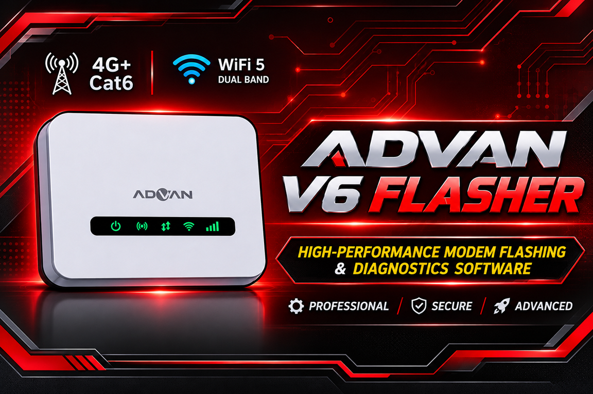

# 🛠️ Advan V6 atau ZLT S50 Toolsuite (Flasher & AIO Utility)



### **Kumpulan Alat Bantu Resmi Firmware MOD & Rescue Toolkit untuk Modem CPE Advan V6 / ZLT S50.**
> Solusi lengkap untuk mengoptimalkan performa, membuka akses sistem, hingga penyelamatan modem secara praktis via Termux Android.

---

### 📌 Navigasi Cepat (Pilih Tool yang Anda Butuhkan)
Repositori ini menyediakan **2 TOOL UTAMA** dengan fungsi yang berbeda. Klik tautan di bawah ini untuk langsung menuju panduan masing-masing:

* [🚀 **1. Advan V6 Flasher** (Pasang Firmware IMBA MOD)](#advan-v6-flasher) — Untuk instalasi fitur-fitur canggih (Bandwidth Limiter, Fix TTL, IMEI, Telegram Bot, dll).
* [🛠️ **2. Advan V6 AIO Utility** (Rescue & Advanced Toolkit)](#advan-v6-utility) — Untuk troubleshooting, aktivasi SSH/Telnet/ADB, Superadmin WebUI, dan perbaikan tanpa perlu flash ulang!

---

## 🛑 PRASYARAT WAJIB (BACA DULU!)
Sebelum menjalankan tool apa pun, pastikan Anda telah memenuhi ketentuan berikut:

> [!IMPORTANT]
> **Registrasi Serial Number (SN)**
> Untuk instalasi Firmware MOD, Anda **WAJIB** mendaftarkan Serial Number (SN) Modem Advan V6 Anda melalui link komunitas IHABT berikut:  
> 👉 [**Daftar SN di Sini (IHABT Facebook Group)**](https://fb.com/share/p/1CDswtfsiY/)

* 📱 **HP Android**: Wajib menggunakan perangkat Android yang terpasang aplikasi **Termux** (disarankan dari F-Droid).
* 📡 **Koneksi Wifi**: HP Android wajib terhubung langsung ke jaringan WiFi modem Advan V6 target.
* 🌐 **Koneksi Internet**: Modem harus memiliki akses internet aktif (minimal kuota 500 MB untuk proses download payload).
* 🔄 **Fresh Reboot**: Reboot modem Anda terlebih dahulu sebelum memulai agar memori bersih dan proses berjalan lancar.
* 🛑 **Idle Mode**: Jangan gunakan modem untuk unduhan berat/streaming saat proses flashing berlangsung.

---

<a id="advan-v6-flasher"></a>
## 🚀 1. Advan V6 Flasher (Installer Firmware MOD)

Tool otomatis untuk memasang **IMBA MOD Firmware** ke modem Advan V6 / ZLT S50 via jalur Over-The-Air (OTA) lokal tanpa perlu bongkar casing atau solder kabel serial.

### ✨ Fitur Unggulan IMBA MOD:
* 🚀 **Bandwidth Limiter / QoS**: Batasi kecepatan download/upload per perangkat (IP / MAC address).
* 🛡️ **Fix TTL (64 / 65 / Custom)**: Bypass kuota tethering hotspot dari berbagai operator seluler.
* 📱 **Change IMEI**: Ganti IMEI modem secara instan untuk kebutuhan fleksibilitas paket data.
* 🔄 **Auto Reconnect / Ping Watchdog**: Otomatis restart koneksi data seluler jika modem kehilangan akses internet.
* 📩 **SMS Monitoring Telegram Bot**: Teruskan SMS masuk (kode OTP, info promo, peringatan kuota) langsung ke Telegram Anda.
* 💡 **Custom LED Control**: Atur mode kedipan atau matikan lampu LED modem sesuai preferensi.
* 🎨 **Modern Dark Theme WebUI**: Tampilan antarmuka web modern, responsif, dan nyaman di mata.
* 🧹 **Built-in Uninstaller**: Kemudahan untuk kembali (*restore*) ke firmware original kapan saja jika diinginkan.

### 📥 Cara Instalasi Flasher di Termux:
1. Hubungkan HP ke WiFi Advan V6.
2. Buka aplikasi **Termux**, salin perintah di bawah ini, tempel (*paste*), lalu tekan **ENTER**:

```bash
pkg update && pkg upgrade -y && pkg install wget -y && \
wget https://raw.githubusercontent.com/armarchindo/advan-v6-flasher/main/advanv6_flasher -O advanv6_flasher && \
chmod +x ./advanv6_flasher && ./advanv6_flasher
```

3. Ikuti instruksi di layar Termux dan tekan **ENTER** pada setiap langkah konfirmasi.
4. Modem akan melakukan restart otomatis saat proses flashing selesai.

### 🔑 Kredensial Akses Pasca-Flash:
* **WebUI (192.168.0.1)**:
  * User Standar: `admin` / Password: `admin`
  * Administrator: `root` / Password: `admin`
  > [!TIP]
  > **Catatan Alternatif Login:** Jika akun `root` / `admin` tidak bisa masuk pada batch/firmware tertentu, silakan gunakan akun alternatif:  
  > Username: **`senior`** / Password: **`123456`**
* **Terminal SSH (Port 22)**:
  * Username: `root` / Password: `ngademin`

---

<a id="advan-v6-utility"></a>
## 🛠️ 2. Advan V6 AIO Utility (Rescue & Advanced Toolkit)

Tool mandiri serbaguna untuk kebutuhan perbaikan (*rescue*), pembukaan akses backdoor sistem, dan manajemen akun tingkat lanjut **tanpa perlu melakukan flash ulang firmware**. Sangat berguna baik untuk modem berkondisi standar pabrik maupun yang sudah terpasang modifikasi.

### 🧰 Menu Fitur yang Tersedia:
| No | Fitur | Deskripsi & Kegunaan |
| :---: | :--- | :--- |
| **[1]** | **Aktivasi Telnet** | Membuka port 23 untuk akses shell Linux instan tanpa password. |
| **[2]** | **Aktivasi SSH & SFTP** | Membuka port 22 (`root:ngademin`) untuk akses remote terminal aman dan transfer file via SFTP/WinSCP. |
| **[3]** | **Aktivasi ADB via USB** | Mengaktifkan antarmuka Android Debug Bridge pada port micro-USB fisik modem (`adb shell`). |
| **[4]** | **WebUI Recovery (/tzwww)** | Memulihkan WebUI jika halaman web blank putih, corrupt, atau error HTTP 500 akibat salah edit file. |
| **[5]** | **Quick Recover Firewall** | Mereset aturan `iptables` dan firewall jika koneksi internet modem terblokir akibat salah aturan limiter. |
| **[6]** | **Manajemen Superadmin WebUI** | Mengaktifkan/menonaktifkan akun WebUI Level 1 (`superadmin`) untuk membuka menu rahasia dan bypass Lock Band secara permanen. |
| **[7]** | **Repair Menu Lock Band** | Memperbaiki bitmask konfigurasi firmware agar menu Lock Band & Lock Cell kembali muncul pada akun `root`. |

### 📥 Cara Menjalankan Utility di Termux:
1. Hubungkan HP ke WiFi Advan V6.
2. Buka aplikasi **Termux**, salin perintah di bawah ini, tempel (*paste*), lalu tekan **ENTER**:

```bash
pkg update && pkg upgrade -y && pkg install wget -y && \
wget https://raw.githubusercontent.com/armarchindo/advan-v6-flasher/main/advanv6_utility -O advanv6_utility && \
chmod +x ./advanv6_utility && ./advanv6_utility
```

3. Pilih nomor menu yang diinginkan (1–7) sesuai kebutuhan Anda.

---

## 👥 Komunitas & Dukungan
Butuh panduan lebih lanjut, diskusi teknis, atau ingin berbagi pengalaman seputar modem Advan V6 / ZLT S50? Bergabunglah dengan grup resmi kami:

[](https://fb.com/share/p/1CDswtfsiY/)

---
<p align="center">
  Disusun dengan ❤️ oleh komunitas <b>IHABT</b>
</p>
