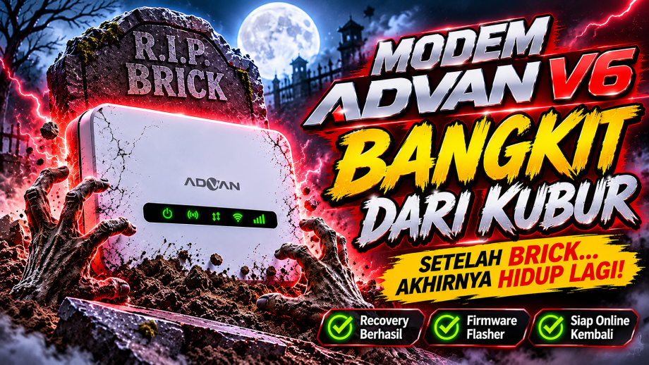

# 🩹 Panduan Lengkap Diagnosa & Pemulihan Soft-Brick Modem Advan V6 (ZLT S50)



> **Platform:** Unisoc SL8563 (ARM Cortex-A7, Architecture ARMv7)  
> **Sistem Operasi:** Embedded Linux (Yocto SL8563)
> **RAM:** LPDDR2 ESMT M54D2G3264A (256MB)  
> **Storage:** SPI NAND Flash DS35M2GA-IB (1.8V, 256MB)  
> **Kondisi Perangkat:** Soft-Brick layer WebUI (HTTP 500 / Halaman Blank), fungsi modem/jaringan tetap aktif normal.

> [!TIP]
> **Link Download Resmi Paket Driver & Script Recovery (.7z):**  
> Seluruh tool pemulihan, script Python (`advan_at_recovery.py`), launcher batch (`install_dependencies.bat`, `run_recovery.bat`), serta paket lengkap Driver USB Unisoc dapat diunduh langsung dalam satu file arsip `.7z` di GitHub Release:  
> 📥 [**Download Driver & Script Recovery Advan V6 (.7z)**](https://github.com/armarchindo/advan-v6-flasher/releases/tag/driver_script)

---

## 1. Analisis Akar Masalah (Root Cause Analysis)

### A. Mengapa WebUI Bisa Rusak (HTTP 500 Internal Error / Halaman Blank)?
1. **Arsitektur Web Server Modem:**  
   Pada modem Advan V6 / ZLT S50, seluruh antarmuka dashboard, API sistem, dan otentikasi ditangani oleh web server embedded **mini_httpd/1.30** dengan direktori web di `/tzwww`. Jantung operasional backend bertumpu pada satu biner executable utama: `/tzwww/cgi-bin/http.cgi`.

2. **Faktor Penyebab Kerusakan WebUI (General Failure Factors):**  
   Kondisi WebUI mengalami blank atau mengembalikan kode kesalahan HTTP 500 secara umum dapat dipicu oleh beberapa faktor teknis:
   * **Hilangnya Izin Eksekusi (*Execution Permission Lost*):**  
     Biner `/tzwww/cgi-bin/http.cgi` wajib memiliki permission execute (`+x` atau mode `0755`). Apabila terjadi perubahan permission menjadi non-executable (`-rw-r--r--`), web server `mini_httpd` akan gagal mengeksekusi proses CGI (`execve()` permission denied) saat menerima permintaan HTTP dari klien, sehingga langsung memunculkan respon:
     ```text
     HTTP/1.1 500 Internal Error
     Something unexpected went wrong running a CGI program.
     ```
   * **Korupsi atau Ketiadaan Pustaka Dependency (*Missing Shared Libraries*):**  
     Biner `http.cgi` merupakan executable dinamis yang membutuhkan shared libraries (`.so`) di direktori `/lib` dan `/usr/lib`. Ketiadaan atau ketidakcocokan versi pustaka pendukung ini akan menyebabkan binary mengalami kegagalan *dynamic linker* (*segmentation fault* atau *library not found*).
   * **Kesalahan Struktur File Web (*Broken Asset/Syntax Error*):**  
     Kerusakan sintaks pada file antarmuka (HTML, JavaScript, atau CSS) di dalam direktori `/tzwww/` dapat menyebabkan browser gagal me-render halaman secara utuh sehingga menghasilkan tampilan layar putih polos (*white screen/blank*).
   * **Integritas File Tidak Lengkap (*Truncated/Corrupted Files*):**  
     File sistem atau asset web yang berukuran 0 bytes atau rusak akibat proses penulisan storage yang tidak tuntas dapat memicu *crash* pada parser web server.

3. **Dampak terhadap Akses Pengguna (*Lockout Effect*):**  
   * Karena WebUI adalah antarmuka utama untuk mengontrol router, rusaknya CGI menyebabkan akses ke menu konfigurasi web terputus.
   * Apabila port remote shell standar (seperti Telnet atau SSH) tidak aktif secara default pada port jaringan IP (LAN/Wi-Fi), pengguna tidak dapat masuk ke terminal sistem melalui jalur koneksi biasa.
   * **Penting untuk Dipahami:** Kondisi ini merupakan **soft-brick murni pada layer WebUI**. Komponen sistem inti—termasuk kernel Linux, driver modem seluler, konektivitas jaringan data, dan antarmuka USB low-level pada SoC Unisoc SL8563—tetap berjalan 100% normal dan dapat dipulihkan tanpa perlu melakukan flashing ulang partisi sistem.

### B. Mengapa UART Tidak Bisa di-Break ke Prompt U-Boot?
Berdasarkan pembacaan binary dump bootloader primer (`mtd1_uboot.bin`, offset `0x65D13`):
* Konfigurasi environment U-Boot:
  ```text
  bootcmd=cboot normal
  bootdelay=0
  baudrate=115200
  preboot=role
  ```
* Nilai **`bootdelay=0`** menginstruksikan U-Boot untuk segera mengeksekusi kernel secara instan (0 milidetik jeda hitung mundur).
* Menekan tombol keyboard secara manual saat power menyala dipastikan terlambat menangkap siklus pembacaan buffer serial.
* Pada build tipe user (`version_type:user`), U-Boot secara otomatis memodifikasi bootargs kernel dari `console=ttyS1` menjadi `console=null`, sehingga terminal login Linux setelah boot juga dinonaktifkan di jalur serial UART fisik.

---

## 2. Prosedur Masuk Mode USB Unisoc (Hardware Trigger)

Modem Advan V6 dilengkapi port Micro-USB yang terhubung langsung ke SoC Unisoc SL8563.

### A. Persiapan Driver di PC (Pilih Sesuai Versi Windows Anda)
Gunakan paket driver resmi Unisoc/Spreadtrum yang telah disediakan pada folder `Driver_Tools_Script/driver/SPD_Driver_R4.20.4201/`. Pilih subfolder installer yang sesuai dengan versi sistem operasi Windows di PC Anda:

1. **Windows 10 & Windows 11:**
   - **Lokasi Folder:** `Driver_Tools_Script/driver/SPD_Driver_R4.20.4201/Win10-Win11/`
   - **File Installer:** Klik kanan **`DPInst64.exe`** (untuk Windows 64-bit) atau **`DPInst32.exe`** (untuk Windows 32-bit) $\rightarrow$ pilih **Run as Administrator**.
2. **Windows 8 & Windows 8.1:**
   - **Lokasi Folder:** `Driver_Tools_Script/driver/SPD_Driver_R4.20.4201/Win8/`
   - **File Installer:** Klik kanan **`DPInst64.exe`** (64-bit) atau **`DPInst32.exe`** (32-bit) $\rightarrow$ pilih **Run as Administrator**.
3. **Windows 7:**
   - **Lokasi Folder:** `Driver_Tools_Script/driver/SPD_Driver_R4.20.4201/Win7/`
   - **File Installer:** Klik kanan **`DPInst64.exe`** (64-bit) atau **`DPInst32.exe`** (32-bit) $\rightarrow$ pilih **Run as Administrator**.

*Driver ini memuat komponen vital:*
* `sprdvcom.inf` (Spreadtrum Virtual COM Port — BootROM & AT/DIAG serial composite)
* `sprdadb.inf` (Spreadtrum Android ADB Composite Interface)
* `sprdvmdm.inf` (Spreadtrum Modem Diag Interface)

### B. Langkah Eksekusi Hardware Trigger
1. Matikan modem dengan mencabut adaptor power (Kondisi OFF).
2. Hubungkan kabel data Micro-USB dari port USB Advan V6 ke port USB laptop/PC.
3. **Tekan dan tahan tombol WPS atau RESET** (jangan dilepas).
4. Sambil tetap menahan tombol tersebut, **colokkan adaptor power modem**.
5. Tahan tombol selama **3–5 detik** hingga terdengar notifikasi USB terhubung di Windows (*nada "tung-tung"*), lalu lepaskan tombol.

### C. Mengenal 2 Jenis Deteksi USB pada Unisoc

1. **Mode BROM Murni (BootROM Download Mode):**
   * **Device di Device Manager:** Hanya muncul 1 port: `SPRD U2S Diag` (`VID_1782 & PID_4d00`).
   * **Karakteristik:** Chip berhenti di BootROM silikon chip sebelum bootloader/OS berjalan. Digunakan khusus untuk emergency full flashing (`spd_dump.exe`).

2. **Mode Running Composite (Mode yang Aktif Saat Soft-Brick WebUI):**
   * **Device di Device Manager:** Muncul satu set port lengkap (`VID_1782 & PID_4045`).  
     *(Catatan: Nomor urut `COMx` akan berbeda-beda di tiap PC tergantung histori port Windows Anda, **selalu perhatikan nama perangkatnya**):*
     * **`SPRD AT`** — Port AT Commands utama (**Kunci Akses Input Perintah**).
     * **`SPRD Common AT`** — Port AT Commands sekunder / konsol output (**Kunci Output Console `/dev/ttyGS5`**).
     * **`SPRD DIAG`** — Port Protokol Diagnostik Unisoc.
     * **`SPRD LOG`** — Port logging kernel/CP.
     * **`SPRD Modem`** — Interface modem serial.
     * **`Remote NDIS based Internet Sharing Device`** — Kartu jaringan virtual RNDIS USB.
   * **Karakteristik:** Menandakan sistem operasi Linux di dalam router dan baseband modem **100% hidup normal**.

---

## 3. Peta Opsi Pemulihan (Recovery Vectors)

| Opsi | Jalur Akses | Deskripsi & Prosedur | Tingkat Risiko |
| :--- | :--- | :--- | :--- |
| **Opsi 1 (Nirkabel / Tanpa Kabel USB)** | **Remote SSH Shell (Port 22 via Wi-Fi/LAN)** | Jika daemon SSH Dropbear sudah aktif (misal bawaan firmware MOD atau diaktifkan sebelumnya), langsung hubungkan terminal ke `ssh root@192.168.0.1`. Anda dapat langsung me-remount root RW, memperbaiki permission `http.cgi`, dan memulihkan file `/tzwww` tanpa kabel data USB. | **Sangat Aman (0% Risiko Brick, Praktis)** |
| **Opsi 2 (Direkomendasikan via USB)** | **USB AT Commands (`SPRD AT` / `SPRD Common AT`)** | Memanfaatkan port serial AT USB untuk mengeksekusi perintah shell langsung, memperbaiki WebUI, serta menghidupkan SSH, Telnet, dan ADB secara instan. | **Sangat Aman (0% Risiko Brick, Tanpa Flash Ulang)** |
| **Opsi 3** | **Unisoc Download Mode (`spd_dump.exe`)** | Men-trigger mode BROM via hardware WPS/Reset, lalu me-restore partisi sistem `mtd7_ubipac.bin` dari backup full-dump. | **Rendah (Aman jika hanya partisi sistem)** |
| **Opsi 4** | **UART Serial Flooding** | Membanjiri buffer UART fisik dengan script loop `Ctrl+C` di kecepatan 115200 baud sebelum power-on untuk menghentikan `bootdelay=0` ke prompt `=>`, lalu boot `init=/bin/sh`. | **Sangat Aman (Jalur Console)** |
| **Opsi 5** | **Fisik SPI NAND Programmer (CH341A)** | Menjepit IC Flash SPI NAND DS35M2GA-IB menggunakan adapter 1.8V dan NeoProgrammer untuk menulis ulang dump secara fisik di motherboard. | **Menengah (Risiko mekanik/voltase)** |

---

## 4. Cara Menjalankan Perintah Linux via AT Command

Pemulihan WebUI dan pembukaan akses shell dilakukan langsung menggunakan perintah `AT+SETUSBINI`. Perintah ini dapat mengeksekusi instruksi shell Linux secara langsung dengan hak akses tertinggi: **`root` (uid=0)** tanpa memerlukan password.

### A. Format Dasar Perintah
Perintah Linux disisipkan setelah karakter titik koma (`;`) pada parameter kedua:
```text
AT+SETUSBINI="a","1; <perintah_linux>"
```

### B. Routing Port Input dan Output Respon
* **Port Input Perintah:** Kirimkan perintah ke port serial bernama **`SPRD AT`** (Baudrate: `115200`).
* **Port Output Respon:** Untuk melihat output atau hasil eksekusi perintah di layar PC, arahkan output ke gadget serial `/dev/ttyGS5` dan baca hasilnya melalui port **`SPRD Common AT`**:
  ```text
  AT+SETUSBINI="a","1; <perintah_linux> > /dev/ttyGS5 2>&1"
  ```
* *(Catatan: Batas panjang teks perintah yang aman dikirim dalam satu baris adalah maksimal **85 karakter**).*

---

## 5. Panduan Praktis Pemulihan Akses & WebUI via AT Command

Berikut adalah langkah-langkah teknis untuk memulihkan akses perangkat:

### A. Cara Menghidupkan Telnet via AT Command

Daemon telnet bawaan sistem dapat diaktifkan secara instan di background melalui port 23:

#### 1. Format Perintah AT:
Kirimkan string berikut ke port **`SPRD AT`**:
```text
AT+SETUSBINI="a","1; telnetd -l /bin/sh -p 23 &"
```
*(Atau memanggil script bawaan router: `AT+SETUSBINI="a","1; /etc/tzscript/telnet_start.sh &"`)*

#### 2. Respon Modem:
* Pada port `SPRD AT`: Modem akan merespon `OK`.
* Di latar belakang, proses `telnetd` langsung berjalan sebagai daemon root.

#### 3. Verifikasi & Login dari PC:
1. Pastikan PC terhubung ke router via LAN atau Wi-Fi (IP default router: `192.168.0.1`).
2. Buka Terminal / CMD / PuTTY di Windows:
   ```cmd
   telnet 192.168.0.1 23
   ```
3. Anda akan langsung masuk ke root shell prompt tanpa password:
   ```text
   BusyBox v1.27.2 () built-in shell (ash)
   Enter 'help' for a list of built-in commands.

   # id
   uid=0(root) gid=0(root) groups=0(root)
   ```

---

### B. Cara Menghidupkan Port Akses Debug & Remote Shell (ADB & SSH Dropbear) via AT Command

Untuk kebutuhan transfer file, remote konsol, dan perbaikan file sistem yang hilang, antarmuka ADB dan SSH Dropbear dapat diaktifkan langsung melalui AT Command:

#### 1. Menghidupkan ADB (Android Debug Bridge)
Tersedia dua metode untuk mengaktifkan antarmuka ADB pada modem Advan V6:

* **Metode 1: Mengaktifkan USB Gadget ADB Bawaan (Native Unisoc)**  
  Unisoc menyediakan konfigurasi enumeration USB bawaan untuk mengaktifkan composite ADB:
  1. Kirim perintah berikut ke port **`SPRD AT`**:
     ```text
     AT+SETUSBINI="usbenum_adb","1"
     ```
     *(Atau alternatifnya: `AT+ADBCTL=1`)*
  2. Perintah ini mengeksekusi `/usr/bin/usbenum.sh set usbenum_adb 1` yang menuliskan konfigurasi composite ADB (`VID_1782 & PID_4045`) dan me-reload driver gadget USB.
  3. Di Device Manager Windows akan muncul perangkat baru: **`Spreadtrum ADB Interface`**.

* **Metode 2: Injeksi Shell Memulai Daemon ADB (`adbd` USB & TCP)**  
  Jika daemon `adbd` belum running di router:
  1. Kirimkan perintah shell injection ke port **`SPRD AT`**:
     ```text
     AT+SETUSBINI="a","1; /usr/bin/adbd &"
     ```
     *(Atau: `AT+SETUSBINI="a","1; /etc/tzscript/adbd_restart.sh &"`)*
  2. Jika ingin menghubungkan ADB melalui jaringan LAN/Wi-Fi (TCP Mode Port 5555):
     ```text
     AT+SETUSBINI="a","1; setprop service.adb.tcp.port 5555 && /usr/bin/adbd &"
     ```
  3. Akses dari PC via command prompt:
     ```cmd
     adb connect 192.168.0.1:5555
     adb devices
     adb shell
     ```

#### 2. Menghidupkan SSH Server (Dropbear Port 22)

> [!IMPORTANT]
> **CATATAN KRUSIAL — DROPBEAR TIDAK TERSEDIA DI FIRMWARE STOCK:**  
> Firmware bawaan pabrik (Stock Firmware original) Advan V6 **TIDAK MEMILIKI binary Dropbear SSH bawaan**. Perintah menjalankan Dropbear via AT Command hanya dapat dieksekusi jika:
> 1. Modem sebelumnya sudah terpasang **Firmware MOD / IMBA MOD** (yang sudah memiliki biner `/usr/bin/dropbear`), **ATAU**
> 2. Anda telah mengunggah (*upload*) biner `dropbear` (arsitektur ARMv7) secara manual ke router.
>
> **Bagaimana Cara Memasukkan Binary Dropbear Jika Modem Soft-Brick?**  
> Saat sistem soft-brick dan akses port jaringan tertutup, **satu-satunya jalur transfer file yang dapat dibuka adalah melalui ADB USB (Metode B.1 di atas)**:
> ```cmd
> # 1. Aktifkan interface ADB USB via AT Command: AT+SETUSBINI="usbenum_adb","1"
> # 2. Remount partisi root ke Read-Write:
> adb remount
> # 3. Upload file binary dropbear ARM dari PC ke modem:
> adb push dropbear /usr/bin/dropbear
> # 4. Berikan izin eksekusi:
> adb shell chmod 755 /usr/bin/dropbear
> ```

Setelah biner `dropbear` dipastikan telah berada di `/usr/bin/dropbear`, jalankan daemon Dropbear melalui AT Command:
1. Jalankan daemon SSH Dropbear di port 22:
   ```text
   AT+SETUSBINI="a","1; /usr/bin/dropbear -R -B -p 22"
   ```
2. Hubungkan dari PC atau terminal (IP modem: `192.168.0.1` port 22):
   ```bash
   ssh root@192.168.0.1
   # (Password: 'ngademin' jika pada firmware IMBA MOD, atau langsung Enter jika binary custom)
   ```

---

### C. Cara Memperbaiki WebUI Blank (HTTP 500) Sesuai Jenis Kerusakannya

> [!WARNING]
> **PERINGATAN: JANGAN MENYAMARATAKAN SEMUA KERUSAKAN WEBUI!**  
> Perintah AT Command `mount -o remount,rw / && chmod 755 /tzwww/cgi-bin/http.cgi` **HANYA BERFUNGSI untuk Kasus 1 (Masalah Izin Eksekusi / Permission Hilang)** saat file web masih utuh!  
> Jangan menganggap perintah `chmod` sebagai satu-satunya cara. Jika kerusakan Anda disebabkan oleh **aset/file web yang corrupt atau terhapus sebagian (Kasus 2)**, atau bahkan **seluruh direktori /tzwww hilang/kosong total (Kasus 3)**, perintah `chmod` sama sekali tidak akan berpengaruh. Anda wajib menyalin kembali file web yang hilang menggunakan metode ADB atau Telnet seperti yang dijelaskan pada Kasus 2 dan Kasus 3 di bawah.

Kondisi WebUI blank putih atau memunculkan pesan error HTTP 500 **memiliki beberapa kemungkinan akar penyebab yang berbeda**. Kenali terlebih dahulu kondisi file di dalam `/tzwww/` sebelum menentukan langkah perbaikan:

---

#### 📌 Kasus 1: Kerusakan Hak Akses (File Web Utuh, Permission CGI Hilang)
* **Karakteristik & Penyebab:**  
  Seluruh file dan folder di `/tzwww` masih lengkap 100%, namun biner backend `/tzwww/cgi-bin/http.cgi` kehilangan izin eksekusi (`+x` / mode `0755`), misalnya akibat salah perintah `chmod` atau script uninstaller/installer pihak ketiga yang keliru mengubah hak akses.
* **Gejala:** Browser memunculkan respon:
  ```text
  HTTP/1.1 500 Internal Error
  Something unexpected went wrong running a CGI program.
  ```
* **Langkah Solusi via AT Command (Cepat & Tanpa Flash Ulang):**
  1. Remount partisi root sistem ke mode Read-Write:
     ```text
     AT+SETUSBINI="a","1; mount -o remount,rw /"
     ```
  2. Kembalikan permission executable biner CGI:
     ```text
     AT+SETUSBINI="a","1; chmod 755 /tzwww/cgi-bin/http.cgi"
     ```
  3. Kembalikan partisi root ke Read-Only demi keamanan memori flash:
     ```text
     AT+SETUSBINI="a","1; mount -o remount,ro /"
     ```
  4. Buka kembali browser ke `http://192.168.0.1/` — WebUI akan langsung pulih normal seketika (HTTP 200 OK).

---

#### 📌 Kasus 2: Sebagian File Web Rusak atau Terhapus (Partial Loss / Corrupted Asset)
* **Karakteristik & Penyebab:**  
  Biner `http.cgi` masih ada dan executable, namun sebagian aset frontend (seperti file HTML dashboard, script JavaScript penting, stylesheet CSS, atau template) di dalam `/tzwww/` terhapus, terpotong (0 bytes), atau mengalami kesalahan sintaks.
* **Bahan File Cadangan:**  
  Arsip backup bersih `/tzwww` resmi dapat diunduh di:  
  📥 [**Download `tzwww.tar.gz` (GitHub Release dump)**](https://github.com/armarchindo/advan-v6-flasher/releases/tag/dump)  
  *(Ekstrak file `tzwww.tar.gz` ini di PC untuk mengambil file yang hilang atau rusak).*
* **Gejala:** Halaman web terbuka namun tampil layar putih polos (*blank white screen*), beberapa tombol/menu hilang, atau console browser (F12) menunjukkan error `404 Not Found` pada aset JS/CSS tertentu.
* **Langkah Solusi via Telnet / ADB / SSH:**
  1. Hidupkan Telnet atau ADB terlebih dahulu (lihat poin A & B di atas).
  2. Masuk ke root terminal modem, lalu remount partisi root ke Read-Write:
     ```bash
     mount -o remount,rw /
     ```
  3. Telusuri direktori `/tzwww/` untuk melihat file mana yang hilang atau berukuran 0 bytes:
     ```bash
     ls -la /tzwww/
     ls -la /tzwww/cgi-bin/
     ls -la /tzwww/js/
     ```
  4. Salin file pengganti yang sehat dari ekstraksi `tzwww.tar.gz` ke modem (misal menggunakan ADB push dari PC):
     ```cmd
     adb push tzwww/js/file_yang_hilang.js /tzwww/js/
     ```
  5. Pastikan seluruh izin file web berstatus dapat dibaca (`644`) dan file cgi/folder berstatus `755`:
     ```bash
     chmod -R 644 /tzwww/*
     chmod -R 755 /tzwww/cgi-bin/
     chmod 755 /tzwww/cgi-bin/http.cgi
     mount -o remount,ro /
     killall mini_httpd; /usr/sbin/mini_httpd -d /tzwww
     ```

---

#### 📌 Kasus 3: Kerusakan Total / Seluruh Folder `/tzwww` Hilang atau Kosong (Full WebUI Loss)
* **Karakteristik & Penyebab:**  
  Seluruh folder `/tzwww` terhapus atau kosong total (misal akibat salah menjalankan perintah `rm -rf /tzwww` atau terjadi kegagalan penulisan partisi UBIFS).
* **Bahan File Cadangan:**  
  Unduh arsip sistem web lengkap bawaan pabrik:  
  📥 [**Download `tzwww.tar.gz` (GitHub Release dump)**](https://github.com/armarchindo/advan-v6-flasher/releases/tag/dump)
* **Gejala:** Browser sama sekali tidak dapat mengakses dashboard (`404 Not Found` atau koneksi web langsung ditolak oleh web server).
* **Langkah Solusi (Deploy Ulang Direktori Web via ADB):**
  1. **PENTING:** Jangan panik dan jangan langsung mem-flash chip secara low-level jika koneksi modem/jaringan masih hidup.
  2. Aktifkan interface ADB via port AT:
     ```text
     AT+SETUSBINI="usbenum_adb","1"
     ```
  3. Buka Command Prompt di PC pada folder tempat file `tzwww.tar.gz` diunduh, lalu kirim dan ekstrak langsung ke dalam modem:
     ```cmd
     adb remount
     adb push tzwww.tar.gz /tmp/tzwww.tar.gz
     adb shell "tar -xzvf /tmp/tzwww.tar.gz -C /"
     adb shell "chmod -R 755 /tzwww/cgi-bin && chmod 755 /tzwww/cgi-bin/http.cgi"
     adb shell "killall mini_httpd; /usr/sbin/mini_httpd -d /tzwww"
     ```
     *(Atau jika `tzwww.tar.gz` sudah Anda ekstrak di PC menjadi folder `tzwww`, Anda cukup menjalankan: `adb push tzwww /tzwww`)*
  4. Web server akan langsung membaca kembali seluruh direktori web dan WebUI kembali aktif normal 100%.

---

## 6. Tabel Cheat Sheet Perintah AT Darurat (Emergency AT Payload Reference)

Seluruh perintah di bawah ini dikirimkan ke port **`SPRD AT`** dengan baudrate **`115200`**:

| Tujuan Pemulihan | Sintaks Payload AT Command Lengkap |
| :--- | :--- |
| **Cek Respon AT Dasar** | `AT` *(Respon: `OK`)* |
| **Uji Injeksi Shell Output** | `AT+SETUSBINI="a","1; echo INJECTION_OK > /dev/ttyGS5"` |
| **Cek Identitas User** | `AT+SETUSBINI="a","1; id > /dev/ttyGS5"` *(Respon di `SPRD Common AT`: `uid=0(root)`)* |
| **Hidupkan Telnet (Port 23)** | `AT+SETUSBINI="a","1; telnetd -l /bin/sh -p 23 &"` |
| **Matikan Firewall Input** | `AT+SETUSBINI="a","1; iptables -F input_mdl_chain"` |
| **Aktifkan USB ADB (Native)** | `AT+SETUSBINI="usbenum_adb","1"` |
| **Hidupkan Daemon ADB** | `AT+SETUSBINI="a","1; /usr/bin/adbd &"` |
| **Perbaiki WebUI (Kasus 1: Khusus Izin Eksekusi)** | `AT+SETUSBINI="a","1; mount -o remount,rw / && chmod 755 /tzwww/cgi-bin/http.cgi"` |
| **Perbaiki WebUI (Kasus 2 & 3: File /tzwww Hilang)** | Buka ADB (`AT+SETUSBINI="usbenum_adb","1"`), lalu `adb push tzwww /tzwww` dari PC (lihat Bagian 5.C) |
| **Restart Web Server HTTP** | `AT+SETUSBINI="a","1; killall mini_httpd; /usr/sbin/mini_httpd -d /tzwww"` |
| **Hidupkan SSH Dropbear (Port 22)**| `AT+SETUSBINI="a","1; /usr/bin/dropbear -R -B -p 22"` *(Biner dropbear wajib sudah ada di router)* |
| **Reboot Router Normal** | `AT+SETUSBINI="a","1; reboot"` |

---

## 7. Tool Otomasi Siap Pakai di PC (Auto-Detect Port)

Telah disediakan script Python interaktif serbaguna: **`advan_at_recovery.py`** beserta script pembantu instalasi dependensi di folder `unbrick/` ini. Skrip ini **secara otomatis mendeteksi nama port serial Spreadtrum** tanpa Anda perlu mencari tahu nomor port manual di Device Manager.

### A. Persiapan Dependensi di Windows (Tinggal Klik):
Script python hanya memerlukan dependensi pustaka `pyserial`. Cukup **klik dua kali** file batch berikut:
* **`install_dependencies.bat`** (atau jalankan via CMD: `.\install_dependencies.bat`).
Script akan otomatis mengecek instalasi Python di PC Anda dan memasang modul `pyserial` yang dibutuhkan.

### B. Menjalankan Tool Recovery:
* **Mode Interaktif Menu (Tinggal Klik di Windows):**  
  Cukup klik dua kali file **`run_recovery.bat`** atau jalankan perintah:
  ```cmd
  python advan_at_recovery.py
  ```
  Program akan menampilkan menu pilihan interaktif (1–6) yang bisa dipilih cukup dengan mengetik angka:
  ```text
  ==================================================
  PILIHAN MENU PEMULIHAN:
    [1] Perbaiki WebUI HTTP 500 Blank (Chmod /tzwww)
    [2] Hidupkan Daemon Telnet (Port 23)
    [3] Hidupkan Daemon ADB (USB & TCP Port 5555)
    [4] Hidupkan SSH Server Dropbear (Port 22)
    [5] Eksekusi Custom Command Linux
    [6] Pindai Ulang Port Serial Spreadtrum
    [0] Keluar
  ==================================================
  ```

* **Mode CLI Argument (Otomasi Script):**
  ```cmd
  # 1. Pindai dan lihat port Spreadtrum yang terdeteksi
  python advan_at_recovery.py --list-ports

  # 2. Menghidupkan Telnet di port 23 (Otomatis)
  python advan_at_recovery.py --telnet

  # 3. Menghidupkan ADB daemon (Otomatis)
  python advan_at_recovery.py --adb

  # 4. Menghidupkan SSH Dropbear port 22 (Otomatis)
  python advan_at_recovery.py --ssh

  # 5. Memperbaiki WebUI HTTP 500 Blank langsung (Otomatis)
  python advan_at_recovery.py --fix-webui

  # 6. Mengeksekusi sembarang perintah Linux
  python advan_at_recovery.py --cmd "ifconfig; uptime"
  ```

---

## 8. Ringkasan File & Bahan yang Dibutuhkan
* **Paket Driver & Script Recovery (.7z):** [Download via GitHub Release](https://github.com/armarchindo/advan-v6-flasher/releases/tag/driver_script) (berisi driver USB Windows, script Python, dan batch launcher).
* **Tool Recovery AT:** Script `advan_at_recovery.py` (tersedia di folder `unbrick/` ini).
* **Script Dependensi Sekali Klik:** `install_dependencies.bat` (menginstal `pyserial`).
* **Launcher Sekali Klik:** `run_recovery.bat` (menjalankan menu interaktif pemulihan).
* **Driver USB Unisoc:** Installer `DPInst64.exe` / `DPInst32.exe` pada folder `driver/SPD_Driver_R4.20.4201/` (pilih subfolder `Win10-Win11/`, `Win8/`, atau `Win7/` sesuai Windows Anda).
* **Bahan Cadangan WebUI Asli (`tzwww.tar.gz`):** [Download via GitHub Release (dump)](https://github.com/armarchindo/advan-v6-flasher/releases/tag/dump) jika mengalami kerusakan file `/tzwww` sebagian atau total.
* **Backup Full Dump (Jika Hard-Brick):** Partisi dump UBI (`mtd7_ubipac.bin`, `mtd1_uboot.bin`, `ubi0_prodnv.bin`).
